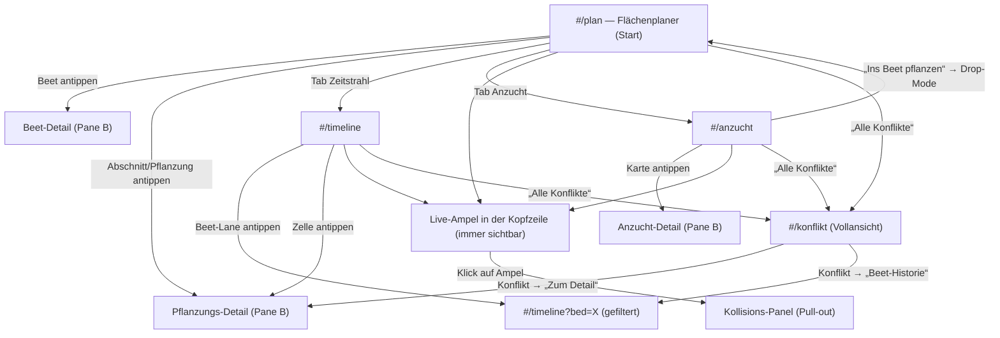

# UI/UX-Konzept „rotato“ — Planungs- und Visualisierungstool für Kleingärten

> **Status:** Entwurf v1.0 (Konzept, nicht implementiert)
> **Kontext:** garten-planer — Linked Data im Solid-Pod, Ontologie in `garten-shapes.ttl`,
> Vokabular in `garten-vokabular.ttl`, bestehende Viewer in `viz/` (plan.html, fruchtfolge.html),
> Pod auf `solid.lasrie.dev` (`/garten/`), Architektur-Stufen laut [ADR-0002](../adr/0002-architektur-stufen.md).
> Dieses Dokument beschreibt die App-Ebene **über** den bestehenden Viewern und den Weg
> von Stufe 2 (Frontend-Direct) zu Stufe 3 (SolidOS-fähige, geteilte Planung).

---

## 0. Design-Prinzipien

| # | Prinzip | Konsequenz für die UI |
|---|---------|----------------------|
| P1 | **Daten im Pod, App ist dünn** | Jede View ist eine SPARQL-Perspektive auf dieselben Tripel. Kein Shadow-State: Was die UI zeigt, kommt aus dem Pod; was die UI ändert, wird als `Pflanzung`-Ressource PUT-tet. Optimistische Updates + Rollback bei Fehlern. |
| P2 | **Pod-Status ist Randnotiz, nicht Aktionszentrum** | Auth-Status klein oben rechts; niemals blocking modal. Unmögliche Schreib-Aktionen werden dezent aktiviert mit Tooltip „Anmelden zum Speichern“. |
| P3 | **Warnungen erklären, nicht schelten** | Jede Kollision zeigt Begründung + Handlungsempfehlung; die Begründung kommt aus dem RDF selbst (z. B. `rdfs:comment` der Fruchtfamilie, Regel-Beschreibung der Konflikt-Engine). |
| P4 | **Planen geht vor Buchen** | Jede Pflanzung trägt `plan:status` (geplant / gepflanzt / geerntet / aufgehoben). Zukunfts-Einträge sind Entwürfe und dürfen ohne Datenverlust geändert werden. |
| P5 | **Tablet-Außeneinsatz** | ≥ 44 px Touch-Targets, hoher Kontrast, die aktuelle Saison dominiert die Ansicht. Kleinkram (Sorten umbenennen, Waiver-Begründungen tippen) ist Desktop-Arbeit. |

---

## 1. Informationsarchitektur & Navigation

### 1.1 Sitemap

```
rotato (statisch auf GitHub Pages, Pod-only-Backend)
├── #/plan        2D-Flächenplaner (Startscreen)
│     ?bed=<slug>        Beet vorselektieren
│     ?planting=<id>     Pflanzung-Detail öffnen
│     ?dropMode=1        Transplant-Flow: Drop-Zonen hervorgehoben
├── #/timeline    Jahres-Fruchtfolge & Zeitstrahl
│     ?bed=<slug>&allYears=1   Filter auf ein Beet, alle Jahre
│     ?scale=weeks             Wochen- statt Monatsraster
├── #/anzucht     Jungpflanzen-Station (Kanban)
│     ?stage=<stadium>         Spalte vorselektieren
├── #/konflikt    Kollisions-Vollansicht
│     ?type=<temporal|rotation|companion>&bed=<slug>
├── #/daten       Pod-Status, Provenance, Debug
└── (keine dritte Navigationsebene — alles Weitere per Query-Param-Deep-Link)
```

**Wichtig:** Die vier Planungs-Screens sind **Perspektiven auf dieselben Daten** (dieselbe
Menge an `Pflanzung`-Ressourcen, dieselbe Beet-Struktur), keine getrennten Bereiche. Ein
Deep-Link ist der Datensatz, nicht eine Seite.

### 1.2 Navigationsmuster: Two-Pane ohne Sidebar

**Entscheidung: Two-Pane ohne Sidebar.** Vier Screens rechtfertigen keine Sidebar; die
Screens sind Perspektiven, keine „Bereiche“.

- **Kopfzeile (56 px):** Wortmarke, vier View-Tabs (Plan / Zeitstrahl / Anzucht / Konflikte),
  rechts das `StatusCluster` (Pod-Status, siehe §2.0).
- **Pane A (links, ~280 px, auf Tablet ausklappbar):** Navigations-Kontext — Beetliste,
  Zeitfilter, Anzucht-Spaltenübersicht, Konfliktliste.
- **Pane B (rechts, restliche Breite):** Detail — Canvas-Plan, Zeitstrahl, Anzucht-Karte,
  Konflikt-Tooltip-Inhalt.

**Smart Defaults:** aktuelles Jahr vorausgewählt; zuletzt besuchtes Beet als `?bed=`
(Vorschlag aus `localStorage` — **localStorage speichert nur UI-Präferenzen, nie
Garten-Daten**; Garten-Daten liegen ausschließlich im Pod).

### 1.3 Screen-Flow



Die Ampel ist überall sichtbar; der Sprung ins Konflikt-Panel ist immer ≤ 2 Klicks entfernt.

---

## 2. UI-Komponenten & Layout-Spezifikation

### 2.0 Zwei Basiskomponenten, die alles tragen

**`<StatusCluster>`** — unaufdringlicher Pod-Status, immer oben rechts:

```
┌──────────────────────────────────────────────┐
│ ● Angemeldet · lasse@solid.lasrie.dev        │   ● grün   = Session aktiv
│   Pod: lasrie.dev/garten · vor 3 Min gespeichert │  „vor 3 Min“ = letzter Schreibzugriff
└──────────────────────────────────────────────┘
Zustände: Angemeldet (grün) · Abgemeldet (grau, „Anmelden“-Button) ·
          Synchronisiere… (amber, Spinner) · Fehler (rot, Retry)
```

WebID und vollständige Pod-URI stehen im Tooltip. Das Cluster zeigt niemals einen Modal,
fragt nie proaktiv nach Login (P2).

**`<BeetChip>`** — kleinste Karteneinheit, wiederverwendet in Plan-Beetliste, Zeitstrahl
und Konflikt-Panel:

```
┌─────────────────────────────────┐
│ Tomatenbeet          ●●●○  ⚠︎1  │   ●●●○ = Fruchtfamilien-Farbdots der
└─────────────────────────────────┘   Belegung (Palette aus FAMILIE_COLOR),
                                      ⚠︎1 = ein offener Konflikt, klickbar
```

### 2.1 Screen 1: `#/plan` — 2D-Flächenplaner

```
┌───────────────┬───────────────────────────────────────────┬──────────────────┐
│ Beetliste     │ SVG-Canvas: Flächenplan                   │ Detail-Panel     │
│ (Pane A)      │                                           │ (Pane B)         │
│               │   ┌─────────────┐  ┌─────────────┐        │ Beet-Detail:     │
│ ▸ Tomatenbeet │   │ Tomatenbeet │  │ Beetkörper W│  …     │  Name, Fläche,   │
│  ●●●○ ⚠︎1     │   │  (Reihe 1–6)│  │ (Reihe 1–4) │        │  Sonnenlage,     │
│ ▸ Erdbeer-…   │   └─────────────┘  └─────────────┘        │  Boden, Ausrich- │
│               │   Reihen als Balken, Abschnitte als       │  tung, Familien- │
│ [Jahr: 2026▾] │   farbige Segmente innerhalb der Reihe    │  Verlauf 3 Jahre │
└───────────────┴───────────────────────────────────────────┴──────────────────┘
```

**Datenbasis:** Geometrien kommen real aus `garten91-beete-real.ttl` (Position/Maße pro
Beet, `garten:Reihe` mit `garten:nutzlaenge`, `garten:abschnittStart/Ende`,
`garten:abschnittInReihe`). Farbcodierung der Segmente nach Fruchtfamilie (Palette aus
`fruchtfolge-logic.js`).

**Pane A (Beetliste):** alle Beete mit Fläche, Fruchtfamilien-Dots der aktuellen Belegung,
zusammengefasstem Konflikt-Badge. Jahres-Wähler oben.

**Canvas:**
- Beete als Rechtecke aus den realen Koordinaten; `Reihe` als horizontale Balken im Beet;
  `ReihenAbschnitt` als farbige Segmente.
- Tap auf Beet → Beet-Detail (Pane B); Tap auf Abschnitt → Pflanzungs-Detail (Pane B).
- Selektions-Zustand lebt in der URL (`?bed=`, `?planting=`) — kein versteckter State.
- Resize von Reihenabschnitten via Handles: **Desktop-only** (P5).

**Drag & Drop:**
- Quellen: Anzucht-Karte (aus `#/anzucht`, MIME `application/x-rotato-planting`) und
  Pflanzenkatalog (`pflanzen.ttl`, MIME `application/x-rotato-catalog`, für Direktsaat).
  HTML5-DnD auf Desktop, Pointer-Events für Touch.
- Ziele: Reihenabschnitte (bestehende) und leere Reihen-Intervalle (neuer Abschnitt).
- **Drop-Validierung vor dem Drop:** der Drag-Ghost pulsiert grün/rot je nach Ergebnis des
  Live-Checks (§4.7). Bei Rot: Drop läuft ins Leere — Ziel pulsiert rot + Shake-Animation,
  Begründung als Toast, **kein State-Change** (P3: System erklärt, ändert nichts).

**Pane B — zwei Zustände:**
- **Beet-Detail:** Name, Fläche (`garten:flaeche`), Sonnenlage/Boden/Ausrichtung
  (SKOS-Konzepte via `skos:prefLabel`), Fruchtfamilien-Verlauf der letzten 3 Jahre als
  Mini-Timeline (aus der Fruchtfolge-Matrix), Aktionen: „Beet-Historie im Zeitstrahl
  öffnen“ (`#/timeline?bed=X&allYears=1`), „Pflanzung hinzufügen“.
- **Pflanzungs-Detail:** Pflanze/Sorte, `plan:status`, Monate (Anzucht/Pflanzung/Ernte),
  Menge, Quelle (Anzucht-Karte oder Direktsaat), Datenherkunft (Provenance: Generator-Lauf
  bzw. letzter PUT), Aktionen: Status ändern, Verschieben (Drag im Canvas bzw.
  Beetwahl-Dialog auf Touch), ggf. Konflikt-Badge mit Begründung.

### 2.2 Screen 2: `#/timeline` — Jahres-Fruchtfolge & Zeitstrahl

```
┌───────────────┬───────────────────────────────────────────────────────────────┐
│ Beet-Spalte   │  Zeitachse: Jan ─── Jun ─── Dez  (oder KW 1–23)               │
│ (140 px)      │                                                               │
│ ┌───────────┐ │  2026: ▓▓▓▓ Nachtschatten ⚠︎ (geplant, gestrichelt)           │
│ ▸Tomatenbeet │  2025: ▓▓▓▓▓▓ Nachtschatten (real)   ← Konflikt-Notch ⚠︎       │
│  ●●●○ ⚠︎1    │  2024: ▒▒▒▒▒ Hülsenfrüchtler (real, abgeschwächt)             │
└───────────────┴───────────────────────────────────────────────────────────────┘
 Kopfzeile: Jahr-Wähler · Schalter Monate/Wochen · „4. Jahr einblenden“-Toggle
```

**Lanes = Beete (Zeilen), x-Achse = Zeit.** Pro Beet-Lane drei Sub-Lanes untereinander
(aktuelles Jahr oben, darunter die zwei Vorjahre, abgeschwächt dargestellt) — die Rotation
ist damit **inline sichtbar** ohne Moduswechsel. Optionaler vierter Sub-Lane per Toggle
(gestützt auf `garten:rotateNachJahren = 4` aus den Daten).

- **Balken:** Pflanzung als Rechteck über `time:hasTemporalExtent` (beginn–ende); Farbe =
  Fruchtfamilie; geplante Pflanzungen gestrichelter Rahmen, reale mit Vollton.
- **Konflikt-Notch:** kleine rote Einkerbung oben am Balken, klickbar → Konflikt-Detail.
- **Heute-Linie:** vertikale Linie „heute“; im Wochen-Modus KW-Nummern als Achsenbeschriftung.
- **Zoom:** Monate (Default) oder KW 1–23 — wichtig für Vor-/Nachkulturen, die sich
  innerhalb eines Monats abwechseln.
- **Interaktion:** Zelle antippen → Pflanzungs-Detail (Pane B); Beet-Lane antippen →
  `?bed=`-Filter als URL-Param (kein versteckter State).

### 2.3 Screen 3: `#/anzucht` — Jungpflanzen- & Anzucht-Station

Kanban mit **fünf Spalten** (Anzucht-Stadien); das Board scrollt horizontal auf dem Tablet,
Spalten sind ~280 px breit:

```
┌────────────┬────────────┬────────────┬────────────┬────────────┐
│  Aussaat   │  Keimung   │ Pikieren   │ Abhärtung  │Auspflanz-  │
│            │            │            │            │reif        │
│ ┌────────┐ │ ┌────────┐ │ ┌────────┐ │ ┌────────┐ │ ┌────────┐ │
│ │Chilli  │ │ │Kopfsalat│ │ │Tomate  │ │ │Paprika │ │ │Basilik.│ │
│ │LilaLuzi│ │ │Baquieu │ │ │SanM. ⏱│ │ │ … ⚠︎   │ │ │ …  ✓   │ │
│ │Feb 25  │ │ │Feb 25  │ │ │→ Mai   │ │ │        │ │ │→ Beet? │ │
│ └────────┘ │ └────────┘ │ └────────┘ │ └────────┘ │ └────────┘ │
└────────────┴────────────┴────────────┴────────────┴────────────┘
```

**Jede Karte ist eine `Pflanzung`-Ressource** (P1) — keine eigenen Karten-Ressourcen. Das
Kanban-Board ist eine SPARQL-Gruppierung der Pflanzungen nach aktuellem Stadium. Stadien-
Sprünge schreiben Annotations-Quads **an die Pflanzung**:

```turtle
<…planungen/2026#e2026_042> anzucht:stage anzucht:Pikiert ;
    anzucht:stageDate "2026-04-14"^^xsd:date .
```

**Karten-Inhalt:** Sorte, Aussaatdatum (`garten:monatAnzucht`), geplanter Auspflanztermin
(`garten:monatPflanzung` + `garten:pflanzZeitpunkt`), Menge, Ort (`garten:anzuchtOrt`:
Fensterbank / Grow-Rack / Folie), Badges (siehe unten).

**Karten-Badges:**
- **AUSPFLANZREIF** (grün): „Ins Beet pflanzen“-Flow verfügbar. Heuristisch aus
  `garten:monatPflanzung` abgeleitet, solange keine expliziten Stadien-Quads existieren
  (§3.3).
- **ZU FRÜH** (blau): heute deutlich vor dem Auspflanztermin — kein Handlungsbedarf.
- **ÜBERFÄLLIG** (rot): heute > geplanter Auspflanztermin + 14 Tage (Schwellwert als
  UI-Konstante, nicht im RDF).

**Dashboard-Header:** Summen pro Spalte („14 Jungpflanzen“), Hervorhebung der „Heute“-
relevanten Spalten, Spalten-Chip „X auspflanzreif“.

**Gruppierung/Facette (Pane A):** nach `garten:anzuchtOrt` (Fensterbank vs. Grow-Rack vs.
Folie) — so findet der Nutzer die Schale auf der Fensterbank wieder. Direktsaaten tauchen
nicht im Kanban auf (sie haben kein Anzucht-Stadium), sondern nur im Plan und Zeitstrahl.

### 2.4 Screen 4: Kollisions-Monitor

Kein eigener Screen im primären Fluss, sondern **Kopfzeilen-Ampel + Pull-out-Panel**;
dazu eine Vollansicht `#/konflikt` für die Saison-Vorplanung.

**Kopfzeilen-Ampel:** `● 2 rot · 3 amber` — klick → Pull-out-Panel (Desktop: rechts,
480 px; Tablet: Bottom-Sheet).

```
┌──────────────────────────────────────────────────────┐
│ ⚠︎ Zeitliche Kollision                        ● rot   │
│ Tomatenbeet, Reihe 3, Abschnitt 2                    │
│ „Tomate ‚San Marzano‘ (gepflanzt) belegt den Ab-     │
│ schnitt noch bis Mitte Oktober, aber die Jungpflanze │
│ ‚Paprika‘ wartet seit 3 Wochen auf ihren Platz.“     │
│                                                      │
│ [Beet-Historie] [Pflanzungs-Detail] [Ignorieren (1 J)]│
└──────────────────────────────────────────────────────┘
```

Pro Konflikt: Titel, betroffene Ressourcen (Beet, Reihe/Abschnitt, Pflanzungen), Begründung
und Handlungsempfehlung (aus der Regel-Beschreibung der Konflikt-Engine, §4.7), Aktionen.

**Gruppierung:** nach Konflikt-Typ (zeitlich / Fruchtfolge / Nachbarschaft), Sortierung:
rot vor amber, dann nach betroffener Fläche.

**Vollansicht `#/konflikt`:** alle Konflikte gruppiert nach Beet × Jahr, Toggle „Nur
geplante“ — für die Winter-Vorplanung.

### 2.5 Screen 5: `#/daten` — Linked-Data-Status & Pod-Integration

```
┌────────────────────────────────────────────────────────────────┐
│ WebID    https://lasse.solidcommunity.net/profile/card#me      │
│ Pod-URI  https://solid.lasrie.dev/garten/                      │
│ Session  ● gültig, verlängert sich automatisch                 │
│ Quellen  Pod-Dokumente (read + write: planungen/*)             │
│          Generator-Docs (read-only: pflanzen.ttl,              │
│          anbau-journal.ttl, mischkultur.ttl — ADR-0006;        │
│          Änderungen nur via Excel → Generator → sync_to_pod)   │
│ Schema   Klassen/Prädikate mit Häufigkeiten (Übersicht)        │
│ Debug    „Turtle anzeigen“ — rohe Turtle der Pod-Ressourcen    │
└────────────────────────────────────────────────────────────────┘
```

**Zentrale Regel:** rotato schreibt **ausschließlich** in `planungen/*` (PUT, read-modify-
write, siehe §4.3). Generator-Docs sind in der App read-only — die Datenherkunft bleibt
über Provenance-Tripel nachvollziehbar (Generator-Lauf, letzter PUT).

---

## 3. Interaktionsdesign

### 3.1 First Run ohne Login

rotato zeigt den Plan **read-only**, wenn der Pod ohne Authentifizierung lesbar ist; sonst
Empty-State „Anmelden zum Sehen“. Der Anmelde-Button ist dezent (P2). Schreib-Aktionen
sind für Unauthentifizierte sichtbar, aber dezent aktiviert mit Tooltip „Anmelden zum
Speichern“ — kein blocking Modal.

### 3.2 Anzucht: Stadien fortschreiben

Karte antippen → Anzucht-Detail (Pane B): Sorte, Aussaatdatum, geplanter Auspflanztermin,
Stadien-Historie. **Drag zwischen Kanban-Spalten = Stadien-Wechsel** = Quad-Write an die
Pflanzung (`anzucht:stage` + `anzucht:stageDate`), optimistisches UI + PUT (§4.3).

### 3.3 Transplant-Flow: „Tomate von der Fensterbank ins Beet“

**Klarstellung (P1):** Die Anzucht-Karte **ist** die Pflanzung-Ressource. Transplantieren
**mutiert** die Pflanzung: es setzt `garten:aufBeet` und `plan:status → "gepflanzt"`. Keine
zweite Ressource, kein Duplikat — eine Pflanzung, eine Wahrheit. Die Karte verschwindet
aus dem Kanban (gefiltert wird auf „ohne `garten:aufBeet`“), bleibt aber über das
Pflanzungs-Detail zugänglich (Stadien-Historie bleibt erhalten).

```
Karte AUSPFLANZREIF
  ↓ Button „Ins Beet pflanzen“
#/plan im Drop-Mode (Beet-Chips pulsieren, Abschnitte hell hinterlegt)
  ↓ Tap auf Ziel-Beet → Tap auf Abschnitt
Live-Check (§4.7): Drag-Ghost pulsiert grün/rot
  ├─ Grün → PUT: garten:aufBeet + plan:status "gepflanzt" → Karte filtert aus dem Kanban
  └─ Rot  → kein State-Change, Ziel pulsiert rot + Shake, Begründungs-Toast (P3)
```

Zweiter Einstieg: Direktsaaten ohne Anzucht starten als Drag aus dem **Pflanzenkatalog**
(Pane A im Plan) direkt auf einen Reihenabschnitt.

### 3.4 Konflikt-Workflow: Fruchtfolgekollision beim Planen von Tomaten

**Szenario:** 2025 standen Tomaten (Nachtschattengewächse) auf dem Tomatenbeet. Der Nutzer
zieht 2026 wieder Tomaten auf dasselbe Beet:

1. **Live-Check während des Drags:** der Ghost pulsiert. Rot = Fruchtfamilie
   „Nachtschattengewächse“ war 2025 (bzw. 2023) auf dem Ziel-Beet und
   `garten:rotateNachJahren = 4` — die Jahres-Differenz unterschreitet den Rotationszyklus.
2. Abschnitt pulsiert rot + Shake, **kein State-Change**. Toast:
   „Tomatenbeet: Nachtschattengewächse 2025 — Fruchtfolge verlangt 4 Jahre Abstand
   (`garten:rotateNachJahren` = 4). Empfehlung: Kartoffelbeet oder Beetkörper West 2026,
   dort war Nachtschatten zuletzt 2022.“
3. Die Empfehlung kommt aus der Konflikt-Engine (§4.7): die Alternativen sind Beete/Jahre,
   in denen die Fruchtfamilie ≥ `rotateNachJahren` Jahre nicht stand — berechnet über die
   Fruchtfolge-Matrix, nicht aus hartcodierten Texten.
4. **Aktionen im Toast:** [Beet-Historie] → `#/timeline?bed=tomatenbeet&allYears=1`;
   [Alternative zeigen] → Beete hervorheben, auf denen die Familie ≥ 4 Jahre abstandnah
   war; [Trotzdem setzen] → Waiver (siehe unten).

**„Trotzdem setzen“ → Waiver:** schreibt eine `plan:Waiver`-Annotation an die Pflanzung
(Begründungsfeld + Jahr). Der Konflikt-Badge bleibt sichtbar, wechselt aber zu amber
(„übersteuert“) — **keine stille Unterdrückung**, die Nutzerentscheidung ist im RDF
nachvollziehbar.

---

## 4. RDF / Linked Data Datenmodell-Skizze

### 4.1 Bestehende Ontologie (kurz wiederholt)

```
Kleingarten ─garten:hatBeet→ Beet ─garten:hatReihe→ Reihe ─garten:hatAbschnitt→ ReihenAbschnitt
Pflanzung ─garten:aufBeet→ Beet, ─garten:pflanzt→ Pflanze, ─garten:sorte→ Sorte
Pflanze/Sorte ─garten:fruchtFamilie→ gv:ff_* (SKOS)
Pflanzung ─time:hasTemporalExtent→ Zeitintervall; monatAnzucht/monatPflanzung/monatErnte
```

rotato erweitert die Ontologie **minimal und additiv** — nichts Bestehendes wird geändert.

### 4.2 Ergänzungen für rotato

**Prüfung gegen das bestehende Modell:** Vieles existiert bereits —

| Anforderung | Existierendes Element |
|---|---|
| Auspflanztermin | `garten:monatPflanzung` (+ `pflanzZeitpunkt`: anfang/mitte/ende) |
| Herkunft Fensterbank / Grow-Rack / Folie | `garten:anzuchtOrt` |
| gekauft vs. selbst angezogen | `garten:gekauft` |
| Fruchtfamilie | `garten:fruchtFamilie` → `gv:ff_*` |
| Beet-Struktur | `Beet → Reihe → ReihenAbschnitt` (garten-layout-ontology.ttl) |

**Neu (drei Elemente + ein Generator-Doc):**

| Neues Element | Zweck | Bemerkung |
|---|---|---|
| `plan:status` | geplant / gepflanzt / geerntet / aufgehoben | SKOS-ConceptScheme in `rotato-vokabular.ttl`; SHACL: 0..1, sh:in der Statusliste |
| `plan:Waiver` | übersteuerte Konflikt-Warnung | Annotation-Quads an die Pflanzung: Begründung (xsd:string) + Jahr; kein Reifikations-Overkill nötig |
| `anzucht:stage` / `anzucht:stageDate` | Stadien-Kette Aussaat → Keimung → Pikieren → Abhärtung → Auspflanzreif | Annotation-Quads an die Pflanzung (`anzucht:stage` ∈ SKOS-Liste, `anzucht:stageDate` xsd:date) |
| `mischkultur.ttl` | Verträglichkeiten | Plant-Pair-Tripel `garten:vertraegtNichtMit` (Allelopathie, Pair-Level, **nicht** Familien-Level); als Generator-Doc (Excel → `generate_mischkultur.py` → `sync_to_pod.mjs`, ADR-0006); Wikidata-Matching via bestehender `match_wikidata.py`-Pipeline |

Bewusst **verworfen** als redundant: ein separates `anzucht:transplantedFrom` — die
Anzucht-Karte ist die Pflanzung selbst (P1); der Transplant-Zeitpunkt ist
`garten:monatPflanzung` bzw. der `anzucht:stageDate`-Eintrag des Stadiens „Auspflanzreif“.

### 4.3 Schreib-Muster (ADR-0004-konform)

```
Lesen:  GET der Pod-Dokumente (Accept: text/turtle) → merged in-memory Store
Prüfen: SHACL-Pre-Check im Browser (rdf-validate-shacl mit denselben .shacl.ttl-Dateien)
        — exakt die Regeln aus ADR-0002 Stufe 2
Schreiben: PUT des ganzen planungen-Dokuments (read-modify-write) mit If-Match-ETag;
           optimistisches UI-Update vor dem PUT, Rollback + Toast bei 409/412
Konflikte (409): Merge-Wizard „Beide haben gleichzeitig gespeichert“ — lokale Änderungen
           auf frische Daten re-applizieren
```

NSS/CSS verstehen PUT auf ganze Ressourcen nativ; SPARQL-UPDATE wird bewusst nicht
verwendet (ADR-0004).

### 4.4 Konflikt-Engine (Regeln als SPARQL über den in-memory Store)

Die drei Konflikt-Klassen laufen als SPARQL CONSTRUCT/ASK **über den zusammengeführten
in-memory Store** (Comunica über lokale Quellen, kein Netzwerk pro Check):

1. **Zeitliche Kollision:** Ziel-Abschnitt ist durch eine bestehende Pflanzung belegt,
   deren `time:hasTemporalExtent` den geplanten Zeitraum der neuen Pflanzung schneidet.
2. **Fruchtfolgekollision:** Fruchtfamilie der neuen Pflanzung == Fruchtfamilie einer
   Pflanzung auf demselben Beet innerhalb der letzten `garten:rotateNachJahren` Jahre.
3. **Nachbarschaftskollision:** `garten:vertraegtNichtMit`-Paar — Nachbarn eines
   Reihenabschnitts sind die angrenzenden `ReihenAbschnitt`-Segmente in derselben `Reihe`.

Die Engine wird einmal nach dem Laden über den gemergten Store gerechnet und bei jeder
Mutation re-run (< 50 ms bei dieser Datenmenge: ~100 Pflanzungen, 9 Beete, 5 Jahre). Das
Ergebnis (`konfliktSummary`) speist die Kopfzeilen-Ampel und alle Badges.

Die Begründungstexte der Warnungen kommen aus der Regel-Definition (Maschinen-lesbare
`rdfs:comment`-Annotationen an den Regel-IRIs), nicht aus hartcodierten UI-Strings —
damit bleibt P3 („erklären, nicht schelten“) auch für Dritte erfüllbar.

---

## 5. Design System & Tech Stack

### 5.1 Tech-Stack-Empfehlung

| Baustein | Empfehlung | Begründung |
|---|---|---|
| Framework | **Svelte 5 (runes) + SvelteKit SPA (`adapter-static`)** | minimale Boilerplate, reaktive `$derived`-Views über den RDF-Store; kein zentrales State-Framework nötig |
| Data Layer | **Comunica SPARQL über LDP**, Session-Fetch via bestehender `viz/solid-auth.js` | funktioniert bereits in `fruchtfolge-logic.js`; Pod-Dokumente als SPARQL-Quellen |
| Auth | **@inrupt/solid-client-authn-browser** (bereits in `viz/solid-auth.js`) | Redirect-URI = Pages-URL; dynamic registration funktioniert out-of-the-box mit solidcommunity.net/CSS |
| Konflikt-Engine | SPARQL CONSTRUCT/ASK über den **in-memory Store** (Comunica über lokale Quellen) | schnell (< 50 ms), offline-fähig nach dem Laden |
| Schreib-Pfad | PUT ganzer planungen-Dokumente + SHACL-Pre-Check (`rdf-validate-shacl`, dieselben `.shacl.ttl`-Dateien) | ADR-0002 Stufe 2 |
| Visualisierung | **SVG-DOM via Svelte-Bindings** (kein Canvas-2D) | Drag/Zoom/Pan deklarativ; a11y via ARIA; RDF-Quads mappen 1:1 auf SVG-Nodes (jeder Reihenabschnitt = `rect` mit Quads als Datenattributen) |
| Tests | **Vitest + Playwright** (Drag-Drop-E2E im Tablet-Viewport) | SHACL-Pre-Check unit-testbar in jsdom via rdf-validate-shacl |
| Deployment | GitHub Pages via `adapter-static` → `viz/` | bestehender Workflow `.github/workflows/pages.yml` deployt `viz/` bereits heute |

**Einordnung:** Die bestehenden vanilla-JS-Viewer (`viz/plan.html`, `fruchtfolge.html`)
funktionieren. Ein Framework-Rewrite ist **kein Muss** — sinnvoller Pfad: die neuen Views
(Zeitstrahl, Anzucht-Kanban, Konflikt-Engine) zuerst als vanilla-JS-Module im Stil von
`fruchtfolge-logic.js` bauen, Svelte-Rewrite später optional, nur wenn die Views
unhandlich werden (gleiche Stufenlogik wie ADR-0002: jeder Schritt hinterlässt etwas
Lauffähiges).

### 5.2 State Management: der Pod ist der Store

```
podGraph (merged RDF Store, einmal geladen, dann optimistic updates)
  ├─ beete          = SELECT … WHERE { ?beet a garten:Beet }
  ├─ pflanzungen(j) = SELECT … WHERE { ?p a garten:Pflanzung ; plan:imJahr j }
  ├─ konfliktSummary = Konflikt-Engine (§4.4) über podGraph → Kopfzeilen-Ampel + Badges
  └─ writer = PUT planungen/<jahr>.ttl; optimistic update podGraph zuerst,
              bei Fehlschlag: Rollback podGraph + Toast
```

Kein separates Frontend-State-Framework; die vier Screens sind $derived-Views über
denselben podGraph — deshalb sehen alle Screens dieselbe Wahrheit zur selben Zeit (P1).

### 5.3 Gestaltungsprinzipien (Farbe, Kontrast, Außeneinsatz)

- **Fruchtfamilien-Farbskala** aus `fruchtfolge-logic.js` (`FAMILIE_COLOR`) als einzige
  Farbquelle für Kultur-Daten — konsistent über Plan, Zeitstrahl und Kanban.
- **Semantische Ampel-Farben:** rot = Kollision, amber = übersteuert (Waiver) oder
  Synchronisation, grün = bereit/konsistent. Blau nur für neutrale Hinweise („zu früh“).
- **Kontrast:** WCAG 2.1 AA (≥ 4.5:1 Text, ≥ 3:1 große Flächen); die Fruchtfamilien-Farben
  werden für Badges/Tooltips mit dunklen Text-Overlays kombiniert, nicht als Textfarbe.
- **Touch:** ≥ 44 px Touch-Targets, Drag-Ghosts ≥ 64 px; Resize-Handles nur Desktop.
- **Außeneinsatz:** hoher Kontrast-Modus als Toggle; die aktuelle Saison dominiert die
  Ansicht (heute-Linie, AUSPFLANZREIF-Spalte, aktuelles Jahr oben im Zeitstrahl).

---

## 6. Offene Fragen

1. **Gleichzeitige Schreibzugriffe:** lasse (Owner) + „Freundin“ (WAC read/write, ADR-0005).
   Read-modify-write mit If-Match-ETag; bei 409: Merge-Wizard „Beide haben gleichzeitig
   gespeichert“ (lokale Änderungen auf frische Daten re-applizieren).
2. **Mischkultur-Datenquelle:** Excel-Liste → Generator (ADR-0006); Wikidata-Matching via
   bestehender `match_wikidata.py`-Pipeline (wie `wikidata-matching.ttl`).
3. **`plan:status` / `plan:Waiver` / `anzucht:stage`** sind bis zur Implementierung Konzept
   (§4.2); bis dahin gelten die bestehenden Dateien (`garten-shapes.ttl`,
   `garten-vokabular.ttl`).
4. **Reihenmodell-Ausbau:** `garten91-linkes-hohes-beet-2025.ttl` modelliert das
   Tomatenbeet als Reihe + Abschnitte — die Ausweitung auf die restlichen Beete ist
   Backlog, kein Blocker (der Plan-Canvas kann solange mit Beet-Rechtecken arbeiten).

---

## Anhang: Umsetzungs-Reihenfolge (Vorschlag)

1. Ontologie-Erweiterungen (§4.2): `plan:status`, `plan:Waiver`, `anzucht:stage/stageDate`
   in Ontologie + Shapes + Vokabular — klein, vorab.
2. Konflikt-Engine (§4.4) als eigenes Modul `viz/konflikt-engine.js` in vanilla JS
   (Stil wie `fruchtfolge-logic.js`), abgeleitet aus der `export_fruchtfolge.py`-Logik.
3. `#/timeline` (Sub-Lane-Zeitstrahl) als nächste View.
4. `#/anzucht`-Kanban → Transplant-Flow + Live-Check (§3.3).
5. Kollisions-Vollansicht `#/konflikt` → `#/daten`.
6. Optional danach: Svelte-Rewrite, nur falls die vanilla-Views unhandlich werden.
